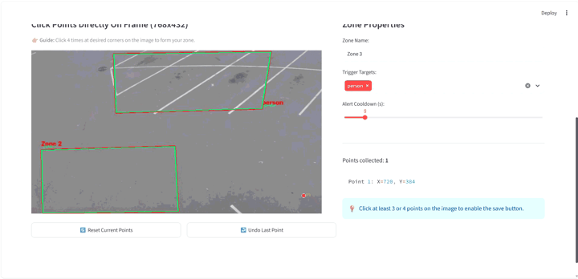
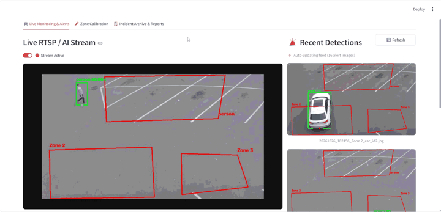
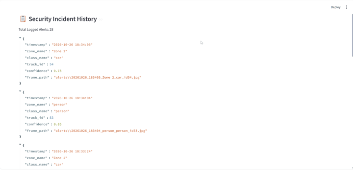

# 👁️ EdgeAI-CCTV: Real-Time Zone Intrusion & Safety Compliance System

[](https://www.python.org/)
[](https://fastapi.tiangolo.com/)
[](https://ultralytics.com/)
[](https://www.docker.com/)
[](https://opensource.org/licenses/MIT)

A production-ready, containerized Computer Vision & Edge AI surveillance system designed for real-time zone intrusion detection, safety compliance, and automated alerting. Built with a modern microservices architecture to mimic enterprise-grade industrial monitoring solutions.

---

## 🚀 Visual Demos & Features

### 1. Interactive Zone Definition
Define customized restricted zones dynamically directly on the video canvas via the interactive web UI.
<p align="center">
  
</p>

### 2. Real-Time Edge AI Stream & Intrusion Detection
YOLO11 processing frames with instant bounding boxes, zone breach checks, and live telemetry.
<p align="center">
  
</p>

### 3. Incident Archive & Snapshot Logging
Automatic alert capture saved to local archive with structured JSON event logs.
<p align="center">
  
</p>

---

## 🎯 Key Features

- **Multi-Zone Intrusion Detection:** Define custom polygonal/rectangular zones dynamically and detect unauthorized entry (e.g., restricted areas, parking zones, industrial hazard sites).
- **Edge AI Engine:** Powered by **Ultralytics YOLO11** optimized for high-accuracy object detection under challenging overhead and standard camera angles.
- **Microservices Architecture:** Decoupled architecture using **FastAPI** as a streaming gateway and an independent AI processing engine communicating via Docker volumes.
- **Low-Latency MJPEG Streaming:** High-performance live video streaming endpoint (`/video_feed`) accessible via standard web clients or downstream dashboards.
- **Automated Incident Logging & Alerts:** Real-time event logging, snapshot capture upon intrusion, and instant notifications (Telegram Bot & desktop alerts).
- **Containerized Deployment:** Fully dockerized with `Docker Compose` for seamless one-command deployment across cloud servers or edge hardware.

---

## 🛠️ Tech Stack

- **Core:** Python 3.11, OpenCV, NumPy
- **Computer Vision Model:** Ultralytics YOLO11 (`yolo11s.pt` / `yolo11n.pt`)
- **API & Streaming:** FastAPI, Uvicorn, Multipart MJPEG
- **Containerization:** Docker & Docker Compose
- **Notifications & UI:** Telegram Bot API, HTML5 Canvas, Streamlit

---

## 📂 Project Structure
```text
.
├── cctv_fixed/
│   ├── run_ai.py           # Core AI processing loop & zone logic
│   ├── fastapi_gateway.py  # FastAPI streaming & gateway server
│   ├── zone_utils.py       # Polygon zone management & configuration
│   └── zone_canvas/        # Interactive canvas UI for zone definition
├── alerts/                 # JSONL logs and captured intrusion snapshots
├── Dockerfile.ai           # Docker configuration for AI Engine
├── Dockerfile.gateway      # Docker configuration for FastAPI Gateway
├── docker-compose.yml      # Orchestration file for microservices
├── requirements.txt        # Python dependencies
├── add_zone.gif            # Demo of zone configuration
├── ai_stream.gif           # Demo of real-time AI intrusion detection
├── incident_archive.gif    # Demo of event logs and snapshot archive
└── README.md
